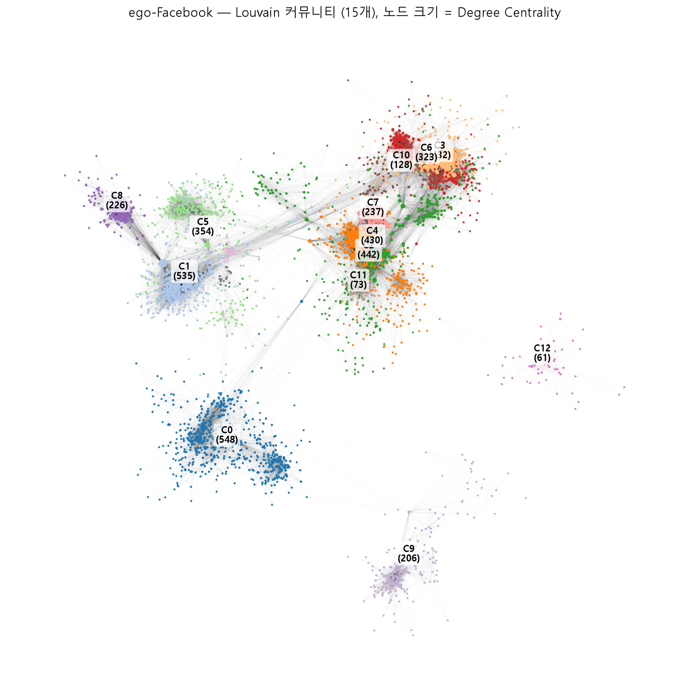

# Network Data Analysis — SNAP ego-Facebook

Facebook 친구 관계 네트워크(SNAP **ego-Facebook**, 4,039 nodes / 88,234 edges)에서 핵심 노드(허브)를 식별하고,
Louvain 커뮤니티 구조를 시각화하여 인사이트를 도출한 분석입니다. (데이터사이언스 10주차 과제)



## 분석 내용
1. **그래프 구성**: 무방향(undirected) · 비가중(unweighted) 그래프
2. **중심성 분석**: Degree, PageRank, Betweenness(정확 계산), Eigenvector — Top 10 비교 및 순위 상관
3. **커뮤니티 탐지**: Louvain → 15개 커뮤니티, Modularity Q = 0.835
4. **Ego-Network 분석**: 핵심 노드 5개(107, 1684, 1912, 3437, 0)의 이웃 subgraph 시각화 및 역할 해석
5. **Pyvis 인터랙티브 시각화**: 전체 네트워크 / 핵심 허브 subgraph

## 주요 결과
- PageRank Top 10이 원본 데이터의 10개 ego(설문 참여자) 노드와 정확히 일치
- Betweenness는 차수가 낮은 다리(bridge) 노드(예: node 58, 차수 12)를 찾아내고, Eigenvector는 가장 밀집된 한 그룹에 점수가 쏠림
- 허브의 역할 구분: 107·1684 = 커뮤니티 간 브로커, 1912 = 밀집 그룹의 중심, 3437·0 = 한 커뮤니티 내부 소그룹들의 관문

## 파일 구성
| 파일 | 내용 |
|---|---|
| `week10_homework.ipynb` | 분석 노트북 (실행 결과 포함) |
| `week10_homework.pdf` | 노트북 PDF |
| `week10_figures.pdf` | 전체 시각화 모음 PDF |
| `figures/` | 시각화 PNG (중심성, 커뮤니티, Ego-network 5개) |
| `week10_network_interactive.html` | Pyvis 전체 네트워크 (다운로드 후 브라우저에서 열기) |
| `week10_hubs_interactive.html` | Pyvis 핵심 허브 + 이웃 subgraph |
| `centrality_results.csv` / `community_summary.csv` | 노드별 중심성 · 커뮤니티 요약 결과 |
| `facebook_combined.txt` | 원본 데이터 ([SNAP](https://snap.stanford.edu/data/ego-Facebook.html)) |

## 실행 방법
```bash
python -m venv .venv
.venv\Scripts\activate          # macOS/Linux: source .venv/bin/activate
pip install -r requirements.txt jupyter
jupyter notebook week10_homework.ipynb
```
환경: Python 3.12.7 / Windows 11. 전체 실행 약 15~20분 (Betweenness 정확 계산 및 레이아웃 계산 포함).

## 데이터 출처
J. McAuley and J. Leskovec. *Learning to Discover Social Circles in Ego Networks.* NIPS, 2012.
https://snap.stanford.edu/data/ego-Facebook.html
