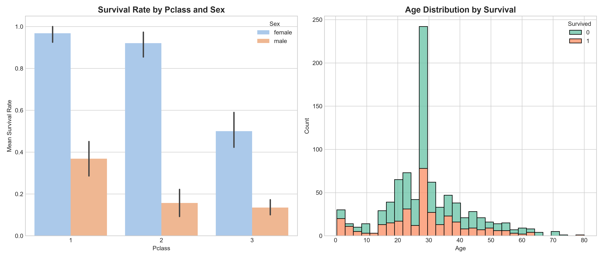

# Python Data Processing — Titanic 데이터 전처리 & 요약

Pandas로 Titanic 승객 데이터의 결측치를 처리하고, `groupby`·`pivot_table`로 생존율을 요약한 뒤
Seaborn으로 시각화한 과제입니다. (데이터사이언스 2주차 과제) NumPy 기초 실습 코드도 함께 포함합니다.



## 분석 내용 (`titanic.py`)
1. **결측치 처리**
   - `Age`(177개 결측) → 중앙값으로 대체
   - `Embarked`(2개 결측) → 최빈값으로 대체
   - `Cabin`(687개 결측) → `'Unknown'`으로 대체
2. **데이터 요약**
   - `groupby('Pclass')`: 객실 등급별 평균 생존율
   - `pivot_table(index='Sex', columns='Pclass')`: 성별 × 객실 등급 생존율 교차 분석
3. **시각화**: 등급·성별 생존율 막대그래프, 생존 여부별 나이 분포 히스토그램

## 주요 결과
전체 생존율은 38.4%입니다.

| 성별 \ 객실 등급 | 1등석 | 2등석 | 3등석 |
|---|---|---|---|
| female | 96.8% | 92.1% | 50.0% |
| male | 36.9% | 15.7% | 13.5% |
| **전체** | **63.0%** | **47.3%** | **24.2%** |

- **성별**이 생존에 가장 큰 영향을 줬습니다. 모든 등급에서 여성의 생존율이 남성보다 2.5~6배 높습니다.
- **객실 등급**이 높을수록 생존율이 높습니다. 3등석 여성(50%)은 1·2등석 여성보다 크게 낮습니다.
- 나이 분포의 28세 부근 막대가 유독 높은 것은 결측치 177개를 중앙값으로 채운 결과입니다. 중앙값 대체가 분포를 왜곡한다는 한계를 보여줍니다.

## 파일 구성
| 파일 | 내용 |
|---|---|
| `titanic.py` | 결측치 처리 · 요약 · 시각화 스크립트 |
| `titanic_visualizations.png` | 시각화 결과 |
| `requirements.txt` | 필요 패키지 |
| `numpy_practice/` | NumPy 배열 생성 기초 실습 (`array`, `zeros`, `arange`, `linspace`) |

## 실행 방법
Titanic 데이터는 Kaggle 이용 약관 때문에 저장소에 포함하지 않았습니다.
1. [Kaggle Titanic 대회](https://www.kaggle.com/c/titanic/data)에서 `train.csv`를 내려받아 이 폴더에 둡니다.
2. 아래 명령으로 실행합니다.

```bash
pip install -r requirements.txt
python titanic.py
```
