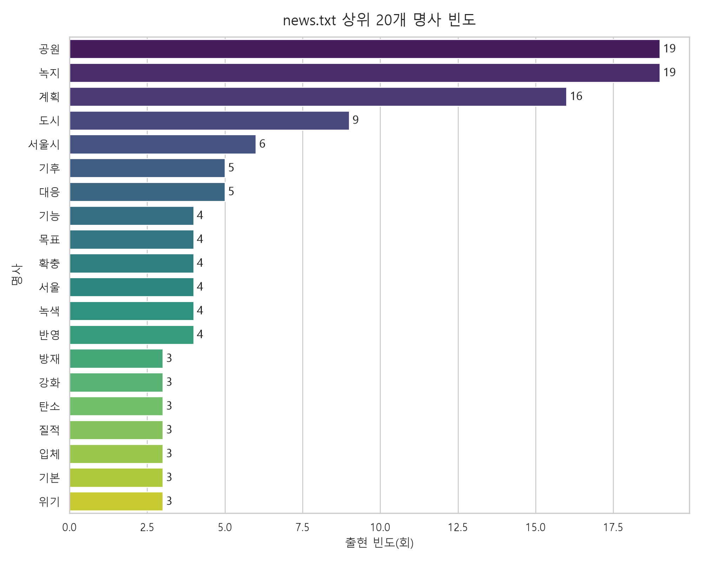

# Text Information Processing — 뉴스 기사 단어 빈도 분석

뉴스 기사(「2040 서울시 공원녹지기본계획」 관련 뉴시스 기사)에서 핵심 명사를 추출하고,
단어 빈도 막대그래프와 워드클라우드로 시각화한 분석입니다. (데이터사이언스 9주차 과제)




## 분석 파이프라인
텍스트 정제(한글만 남김) → 형태소 분석(KoNLPy `Okt`, 명사 추출) → 불용어·한 글자 명사 제거 → 빈도 계산 → 막대그래프 + 워드클라우드

## 주요 결과
- 최빈 단어: **공원(19), 녹지(19), 계획(16)** → 기사의 중심 소재가 서울시 '공원녹지기본계획'임을 확인
- '기후'·'대응'·'위기'·'방재'·'탄소' → 계획의 목적이 기후 위기 대응과 재해 방지
- '질적'·'입체'·'기능'·'강화' → 녹지 면적 확대보다 질적 개선을 강조하는 기사 논조와 일치
- 한계: '공원녹지기본계획'이 '공원/녹지/기본/계획'으로 분리되어 해당 단어들의 빈도가 함께 높아짐

## 파일 구성
| 파일 | 내용 |
|---|---|
| `week09_homework.ipynb` | 분석 노트북 (실행 결과 포함) |
| `9week_homework.py` | 노트북과 동일한 내용의 스크립트 (jupytext percent 형식) |
| `news.txt` | 분석 대상 기사 원문 — **저작권 문제로 저장소에 포함하지 않음** (`.gitignore`) |
| `output/top_words.csv` | 상위 20개 명사 빈도표 |
| `output/top20_bar.png`, `output/wordcloud.png` | 시각화 결과 |
| `requirements.txt` | 필요 패키지 |

## 실행 방법
1. 아래 [데이터 출처](#데이터-출처)의 기사 본문을 복사해 이 폴더에 `news.txt`(UTF-8)로 저장합니다.
2. KoNLPy는 **Java(JDK)** 가 필요합니다. JDK를 설치하고 `JAVA_HOME`을 설정하거나, 이 폴더의 `.jdk/` 아래에 JDK를 두면 노트북이 자동으로 인식합니다.

```bash
python -m venv .venv
.venv\Scripts\activate          # macOS/Linux: source .venv/bin/activate
pip install -r requirements.txt
jupyter notebook week09_homework.ipynb   # 이 폴더에서 실행 (news.txt를 현재 폴더에서 읽음)
```

## 데이터 출처
뉴시스, 2040 서울시 공원녹지기본계획 관련 기사 — https://www.newsis.com/view/NISX20250205_0003054569
기사 원문의 저작권은 뉴시스에 있어 원문 파일은 저장소에 포함하지 않았습니다. 분석 결과(빈도표·시각화)만 공개합니다.
